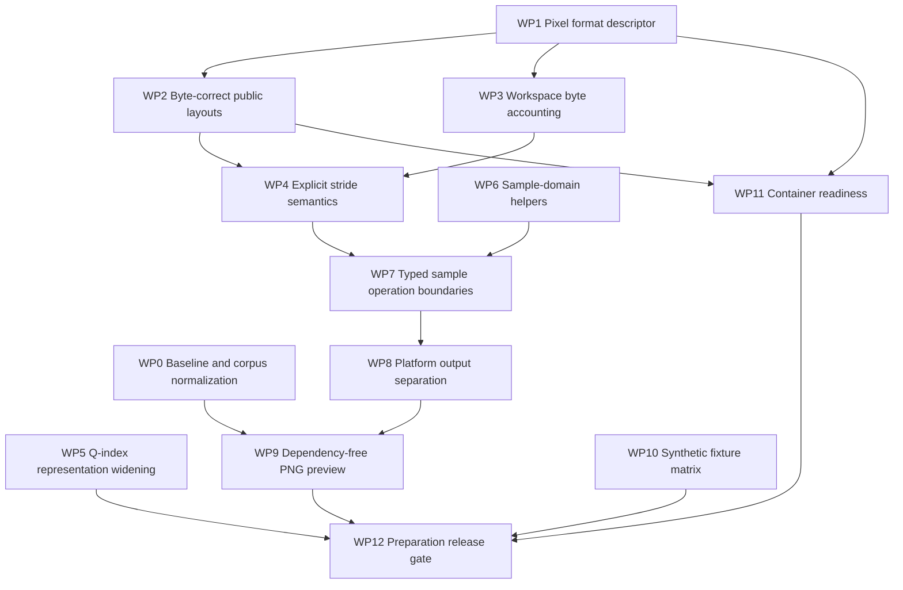

# 10-bit decoder preparation work

## Purpose

Prepare the decoder for 10-bit 4:2:0 and 4:4:4 without implementing normative
10-bit reconstruction yet. The work is intended to remove accidental 8-bit
assumptions from interfaces, storage calculations, and test infrastructure
while preserving the current byte-exact 8-bit output.

This is a sequence of independently reviewable changes, not a speculative
rewrite. Every package must keep the production decoder freestanding C11,
allocator-free, libc-free, and free of external runtime dependencies.

## Relationship to the roadmap

`plan.md` defines the next implementation phases as 10-bit 4:2:0 and 10-bit
4:4:4. This document covers only preparation that can land before either phase
starts changing normative decoded samples.

The preparation phase should leave the codebase in a state where the first
10-bit implementation change is a deliberate vertical slice rather than a
mixture of public-layout fixes, workspace-size repairs, sample widening,
quantizer widening, CLI behavior, and fixture creation.

## Current baseline

The decoder currently supports these tightly packed 8-bit planar outputs:

- I400: one full-resolution 8-bit Y plane.
- I420: full-resolution 8-bit Y and half-resolution 8-bit U/V planes.
- I444: full-resolution 8-bit Y/U/V planes.

The native 10-bit source corpus under `images/artifacts/10bit/` uses:

- 16-bit RGB PNG files as hosted source masters;
- `yuv420p10le` and `yuv444p10le` as `avmenc` inputs; and
- AV2 `.obu` streams as decoder inputs.

The corresponding AVM references use headerless planar output with each sample
stored in a 16-bit little-endian word and only the low 10 bits significant.

The existing photographic matrix provides broad realistic coverage but is not
a substitute for small synthetic fixtures. It contains three photographs, two
resolutions, two chroma formats, and QP 96, 128, and 160. The generated AVM
reference directory is intentionally ignored by Git for now.

## Format decisions

### PNG is a decoder preview output, not an input

The RGB16 PNG files are fixture-generation inputs. They are consumed by hosted
tools before AV2 encoding. The production decoder consumes AV2 OBU or HEIF
input and therefore does not need a PNG parser. It should, however, be able to
write PNG as a convenient visual output alongside BMP and exact planar YUV.

PNG is the most portable desktop-viewable choice and can be implemented without
an external dependency. A minimal deterministic writer needs the PNG signature,
IHDR/IDAT/IEND chunks, CRC-32, a zlib wrapper with Adler-32, and valid DEFLATE
stored blocks. Stored blocks do not compress the image, but every conforming PNG
viewer can read them and the implementation remains small, bounded, streaming,
and suitable for the no-libc target. Compression can remain a hosted or later
optimization.

### Reuse the CC0 newos shared substrate

The sibling checkout at `~/newos/src/`, especially `~/newos/src/shared/`, is
the preferred source for dependency-free, no-libc building blocks that would
otherwise require an external library. This project already uses an adapted
part of that CC0 substrate. At preparation-plan review time, the local newos
checkout was at revision `f4391afd003cd629166d3626a9261360b85115fb` and its
root `LICENSE` declared CC0-1.0.

Relevant code should be audited and selectively copied or adapted into this
repository's `src/shared/`; the build must never depend on the developer's
`~/newos` checkout. Adapted interfaces must use the local namespace, checked
size arithmetic, caller-owned or bounded storage, and the repository's
freestanding headers. Record the exact source revision, imported paths, local
destination paths, and material adaptations in `provenance/cc0-sources.md`
when each import lands.

For PNG output, the current newos tree provides candidate CRC-32 and
zlib/DEFLATE primitives under `src/shared/compression/`. Its
`src/shared/image/png.c` currently probes PNG metadata rather than writing PNG,
so it is useful implementation evidence but is not by itself the required
encoder. Reuse the applicable shared primitives instead of independently
reimplementing them, then adapt or add only the bounded streaming writer logic
needed by this decoder. Do not import PNG parsing into the production decoder
merely because it exists in the sibling substrate.

### Raw YUV output already exists

The current `.i400`, `.i420`, and `.i444` outputs are raw planar YUV. Their
extensions also imply 8-bit storage. They must continue to mean exactly that.

Ten-bit output must not be described as ordinary I420 or I444. The intended
contract is:

- format name `yuv420p10le` or `yuv444p10le`;
- tightly packed Y, U, V plane order;
- unsigned 16-bit little-endian storage words;
- 10 significant bits with values in the range 0 through 1023; and
- no row padding unless a future API explicitly reports it.

A generic `.yuv` CLI output may be added after the decoded format is reported
explicitly. The filename suffix alone is not enough to recover width, height,
chroma format, bit depth, storage width, or byte order.

### Preview output is not reference output

BMP and PNG are human-inspection outputs. They must not replace or modify the
exact planar reference output used for sample parity.

PNG should initially encode the existing 8-bit RGB preview. The writer should
also support PNG's 16-bit big-endian RGB sample representation so a future
10-bit YUV-to-RGB conversion can preserve precision rather than forcing an
8-bit preview. A separate explicit option may still request an 8-bit preview
for maximum compatibility.

YUV-to-RGB conversion must receive the decoded range and matrix contract. When
raw OBU input does not provide sufficient color metadata, the CLI must use a
documented default or explicit user option rather than silently claiming a
color space in PNG metadata.

## Preparation rules

1. Each package must preserve all existing 8-bit decoded bytes.
2. Refactors must not silently widen entropy contexts, mode maps, CDF state, or
   other byte-sized syntax/control storage.
3. Sizes used for allocation, bounds, overlap checks, and public layouts are
   byte counts. Typed kernel strides are sample counts. Names and tests must
   make that distinction explicit.
4. Normative inner loops must use typed 8-bit or 16-bit sample access. Do not
   introduce per-sample callbacks or untyped `void *` arithmetic.
5. Keep current 8-bit entry points as wrappers while callers migrate.
6. Do not combine a behavior-preserving refactor with new 10-bit arithmetic.
7. Run the narrowest owning test after each change and the full 8-bit parity,
   sanitizer, freestanding, and no-libc gates before completing a package.
8. Generated reference changes must pin the AVM revision, commands, hashes,
   dimensions, and raw output contract.

## Dependency order



WP5 and WP6 may proceed in parallel with WP2 through WP4 after the baseline is
  locked. WP10 may start immediately because it changes hosted generation and
reference data rather than decoder behavior.

## Work packages

### WP0: Lock the preparation baseline

**Status:** Implemented on 2026-08-10. Exact ledgers, queried layout/workspace
values, AVM profile and corpus evidence, census results, and platform gate
status are recorded in `docs/dev/10bit-prep-wp0.md`.

**Objective:** Establish a trustworthy before/after gate and ensure the 10-bit
reference streams do not accidentally require unrelated unsupported tools.

**Work:**

- Record the current complete 8-bit I400/I420/I444 output hashes.
- Record public query layouts, workspace sizes, state sizes, and alignments for
  the existing tiny, odd, ordinary, and high-detail fixtures.
- Confirm sanitizer, freestanding, native, no-libc, Windows, and WebAssembly
  gates that are expected to remain unchanged.
- Regenerate 10-bit 4:2:0 and 4:4:4 reference streams with an explicit supported
  tool profile.
- Explicitly set `--enable-restoration=0` for 4:2:0 as well as 4:4:4 unless
  restoration is deliberately moved into the implementation scope.
- Keep the photographic QP 96/128/160 matrix, but treat it as an acceptance
  corpus rather than the only correctness corpus.

**Deliverables:**

- A recorded baseline for bytes, layouts, workspace, and platform gates.
- A consistent AVM command profile for both chroma formats.
- A manifest field or documented list identifying every intentionally enabled
  and disabled sequence-level coding tool.

**Validation:**

- All existing 8-bit hashes remain exact.
- Every AVM reference regenerates byte-for-byte with the pinned AVM build.
- Every generated stream decodes successfully with `avmdec`.
- `av2-census` confirms bit depth, base Q-index, dimensions, and expected stream
  structure.

**Estimated effort:** 1 to 2 days.

### WP1: Define an explicit decoded pixel-format descriptor

**Status:** Implemented on 2026-08-10. Descriptor semantics, public ABI review,
inspection integration, and platform validation are recorded in
`docs/dev/10bit-prep-wp1.md`.

**Objective:** Describe decoded memory independently of filename conventions.

**Work:**

- Add an internal pixel-format descriptor containing at least:
  - chroma format;
  - significant bit depth;
  - storage bits or bytes per sample;
  - storage byte order; and
  - plane order.
- Add or extend public query fields so a caller can distinguish 8-bit packed
  bytes from 10-bit samples stored in 16-bit words.
- Preserve `bits_per_channel`, but do not rely on it alone to describe memory.
- Add helpers that derive plane count and chroma dimensions from the descriptor.
- Initially construct only the existing 8-bit descriptors.

A representative shape is:

```c
typedef enum {
    AV2H_SAMPLE_U8,
    AV2H_SAMPLE_U16LE
} Av2hSampleStorage;

typedef struct {
    uint8_t chroma_format_idc;
    uint8_t bit_depth;
    uint8_t bytes_per_sample;
    Av2hSampleStorage storage;
} Av2hPixelFormat;
```

The final names may follow existing repository conventions. The important part
is that sample precision and storage width are separate facts.

**Deliverables:**

- One authoritative decoded-format description.
- No CLI or platform code inferring sample width from chroma format.
- Query tests for all currently supported 8-bit formats.

**Validation:**

- Public ABI compatibility is reviewed explicitly if public structs change.
- Current query results and decoded bytes remain unchanged.
- Invalid descriptor combinations fail closed.

**Estimated effort:** 1 to 2 days.

### WP2: Make public plane layouts byte-correct

**Status:** Implemented on 2026-08-11. Checked byte arithmetic, two-byte layout
vectors, public unit documentation, and platform validation are recorded in
`docs/dev/10bit-prep-wp2.md`.

**Objective:** Remove the assumption that one sample always occupies one byte
from public output-size and plane-layout calculations.

**Work:**

- Change the plane-layout helper to accept bytes per sample.
- Compute `row_bytes` as checked `width * bytes_per_sample`.
- Compute plane size as checked `row_bytes * height`.
- Compute offsets and total output size with checked byte arithmetic.
- Preserve tightly packed output and existing offsets for 8-bit formats.
- Add standalone layout tests for one-byte and two-byte storage without yet
  admitting a 10-bit stream to normative decode.
- Cover monochrome, 4:2:0, and 4:4:4; odd width and height; zero/invalid input;
  maximum configured dimensions; and every multiplication/addition overflow.

**Deliverables:**

- Byte-correct `Av2hPlaneLayout` calculations.
- Focused two-byte storage layout vectors.
- Explicit documentation that offsets, sizes, and row strides are bytes.

**Validation:**

- Existing 8-bit public query snapshots remain exact.
- Two-byte layout tests produce the expected doubled row and plane sizes.
- Limit failures retain their current error ownership and precedence.

**Estimated effort:** 2 to 3 days.

### WP3: Make workspace accounting sample-width-aware

**Status:** Implemented on 2026-08-11. The workspace-region classification,
two-byte accounting model, query/bind boundary, and platform evidence are
recorded in `docs/dev/10bit-prep-wp3.md`.

**Objective:** Parameterize only sample-backed workspace regions by storage
width while keeping syntax and control maps narrow.

**Work:**

- Inventory every workspace region and classify it as:
  - sample-backed;
  - coefficient/intermediate;
  - syntax/context; or
  - filter-control metadata.
- Multiply only sample-backed coded planes, predictor planes, filter stages,
  reference storage, and output staging by bytes per sample.
- Keep CDFs, partition maps, coefficient contexts, reconstructed-availability
  maps, filter control maps, and mode state at their existing widths unless a
  separate normative reason requires a change.
- Add checked two-byte workspace query tests without enabling 10-bit decode.
- Preserve current alignment unless typed 16-bit storage requires a deliberate,
  tested increase.

**Deliverables:**

- A documented workspace-region classification.
- Sample-width-aware workspace size and alignment queries.
- Overflow and maximum-workspace tests for both storage widths.

**Validation:**

- Current 8-bit workspace sizes and state sizes remain exact.
- Two-byte sample regions double where expected; unrelated regions do not.
- Allocation bounds, overlap rejection, and failure atomicity still pass.

**Estimated effort:** 2 to 4 days.

### WP4: Make stride units explicit

**Status:** Implemented on 2026-08-11. The unit-bearing rename inventory,
private layout review, build-tree cleanup, and platform evidence are recorded
in `docs/dev/10bit-prep-wp4.md`.

**Objective:** Prevent byte/sample unit errors when typed 16-bit samples are
introduced.

**Work:**

- Review every plane and reference structure whose field is named `stride`.
- Use `stride_samples` for typed sample arrays.
- Use `row_bytes` or `stride_bytes` for byte-oriented public and untyped
  storage.
- Use `size_bytes` for allocations, ranges, and overlap checks.
- Add assertions or helper contracts at conversion boundaries.
- Keep this package mechanical: no arithmetic or output changes.

**Deliverables:**

- Consistent unit-bearing names in sample, filter, workspace, and output code.
- No API where the meaning of a stride changes with bit depth.

**Validation:**

- Compiler and focused layout/workspace tests pass immediately after the rename.
- Full output parity remains byte-exact.
- No state size changes unless explicitly reviewed.

**Estimated effort:** 1 to 2 days.

### WP5: Widen Q-index representation without changing 8-bit syntax

**Status:** Implemented on 2026-08-11. The Q-index representation inventory,
preserved 8-bit boundaries, private layout review, and platform evidence are
recorded in `docs/dev/10bit-prep-wp5.md`.

**Objective:** Remove narrowing points before high-bit-depth AV2 introduces the
9-bit Q-index domain.

**Background:** AVM uses an 8-bit Q-index field for 8-bit sequences and a 9-bit
field for higher bit depths. QP 128 in the current 10-bit reference matrix
produces base Q-index 176, but the legal high-bit-depth domain extends beyond
255.

**Work:**

- Inventory base, current, delta-adjusted, per-transform, and deblock Q-index
  fields and parameters.
- Widen Q-index state and interfaces that can carry normative Q-index values to
  `uint16_t` or a named Q-index type.
- In particular, remove `uint8_t` narrowing from deblock cells and deblock-map
  commit interfaces.
- Keep current frame parsing at eight bits during this package.
- Keep current 8-bit clamps and quantizer tables during this package.
- Add tests proving values above 255 survive storage and plumbing even though
  normative 10-bit table lookup is not yet enabled.

**Deliverables:**

- One consistent Q-index representation across frame, leaf, coefficient,
  dequantization, and filter handoff code.
- No implicit narrowing conversions.

**Validation:**

- All existing Q-index and deblock vectors remain exact.
- Strict conversion warnings remain clean.
- Existing 8-bit frame parsing and output are unchanged.

**Estimated effort:** 1 to 2 days.

### WP6: Centralize sample-domain semantics

**Status:** Implemented on 2026-08-11. The centralized domain contract,
semantic-literal inventory, preserved algorithm constants, and platform
evidence are recorded in `docs/dev/10bit-prep-wp6.md`.

**Objective:** Distinguish semantic sample constants from fixed algorithm
coefficients before introducing 10-bit values.

**Work:**

- Introduce a small sample-domain description containing:
  - bit depth;
  - bytes per sample;
  - midpoint; and
  - maximum sample value.
- Initially instantiate only `{ 8, 1, 128, 255 }`.
- Classify hard-coded `128`, `255`, and bit-depth shifts in prediction,
  reconstruction, and filters.
- Replace only semantic midpoint/maximum uses with named domain helpers.
- Do not replace interpolation weights, normalization constants, transform
  scales, probability values, or other algorithm constants merely because
  they numerically equal 128 or 255.
- Keep `av2h_sample_clip` as an 8-bit wrapper while adding a width-neutral
  clipping primitive suitable for future 10-bit callers.

**Deliverables:**

- A reviewed inventory of semantic bit-depth dependencies.
- Central helpers for midpoint, maximum, and clipping bounds.
- Existing 8-bit call sites converted in small owning-module changes.

**Validation:**

- Focused prediction, reconstruction, and filter vectors remain exact after
  each owner migrates.
- No broad search-and-replace of numeric constants.
- Full 8-bit parity remains exact.

**Estimated effort:** 2 to 4 days.

### WP7: Establish typed sample-operation boundaries

**Status:** Implemented on 2026-08-11. The typed-operation inventory,
depth-specialization decision, caller contracts, focused vectors, and platform
evidence are recorded in `docs/dev/10bit-prep-wp7.md`.

**Objective:** Prepare kernels for 8-bit and 16-bit implementations without
introducing untyped inner-loop access or duplicating the whole decoder early.

**Work:**

- Identify the smallest shared sample operations:
  - plane fill;
  - plane copy;
  - visible crop;
  - reference load;
  - predictor commit;
  - reconstructed-sample load; and
  - sample clip/store.
- Give these operations typed 8-bit entry points and tests.
- Define where later 16-bit entry points will sit, but do not implement every
  10-bit predictor or filter in this package.
- Retain existing private entry points as forwarding wrappers where needed.
- Avoid per-sample function pointers, generic callbacks, and `void *` indexing
  in normative loops.
- Decide and document whether kernels use separate `_u8`/`_u16` functions or
  depth-specialized translation-unit templates/macros. Prefer the simplest
  style consistent with current C11 conventions.

**Deliverables:**

- Explicit typed boundaries around sample-bearing operations.
- A short design note selecting the depth-specialization approach.
- No broad code duplication before 10-bit vectors exist.

**Validation:**

- Each extracted operation has focused 8-bit vectors.
- Existing reconstruction/filter outputs remain byte-identical.
- Freestanding and undefined-symbol gates remain clean.

**Estimated effort:** 2 to 4 days.

### WP8: Separate raw output from preview rendering

**Status:** Implemented on 2026-08-11. The raw naming policy, shared preview
contract, exact BMP evidence, unsupported-combination behavior, and platform
validation are recorded in `docs/dev/10bit-prep-wp8.md`.

**Objective:** Keep exact planar output authoritative and make platform preview
conversion depth-aware without duplicating codec layout assumptions.

**Work:**

- Treat `.i400`, `.i420`, and `.i444` as strict 8-bit raw-output names.
- Add a shared output-format naming helper that can eventually report
  `yuv420p10le` and `yuv444p10le`.
- Decide whether the CLI will accept generic `.yuv` or require an explicit
  `--format`/metadata report. Do not infer 10-bit storage from `.yuv` alone.
- Extract planar-to-BGR8 row conversion from Linux, POSIX, and Windows file I/O.
- Give the conversion kernel explicit chroma-format, bit-depth, range, and
  sample-storage inputs.
- Initially preserve only the existing 8-bit conversion behavior.
- Keep platform-specific writing and allocation outside the shared conversion
  kernel.
- Define future 10-bit BMP behavior as explicit preview downconversion, never
  as the reference result.
- Define a row-oriented RGB interface that both BMP and PNG writers can consume
  without allocating another complete image.

**Deliverables:**

- One tested color-conversion owner instead of three copies of 8-bit constants.
- A documented raw-output naming policy.
- Platform wrappers that continue producing the same BMP bytes.
- A streaming RGB-row contract ready for PNG output.

**Validation:**

- Existing raw outputs and BMP files remain byte-identical on all platforms.
- Unsupported extension/format combinations fail before writing output.
- The no-libc target gains no new dependency or undefined symbol.

**Estimated effort:** 2 to 3 days.

### WP9: Add dependency-free PNG preview output

**Status:** Implemented on 2026-08-11. The CC0 audit, streaming PNG contract,
8-bit CLI integration, 16-bit writer boundary, deterministic hashes, and
platform evidence are recorded in `docs/dev/10bit-prep-wp9.md`.

**Objective:** Let a regular user open decoded output in standard desktop image
viewers while keeping exact planar YUV as the normative comparison result.

**Work:**

- Audit the CC0 PNG, CRC-32, and zlib/DEFLATE support in `~/newos/src/shared/`
  at a recorded revision before writing replacements. Prefer adapting the
  applicable checksum and stored-DEFLATE primitives into this repository.
- Place the adapted primitives and small PNG writer in this repository's
  `src/shared/` so hosted and no-libc platform CLIs use one implementation.
  The sibling checkout must not become a build input.
- Keep the implementation dependency-free and streaming. It must not require
  zlib, libpng, heap allocation proportional to the complete image, temporary
  files, or hosted libc.
- Emit the PNG signature and deterministic IHDR, IDAT, and IEND chunks.
- Implement incremental CRC-32 for PNG chunks and Adler-32 for the zlib stream.
- Emit valid DEFLATE stored blocks initially. Compression is not required for
  correctness or desktop compatibility.
- Use PNG filter type 0 initially so each row is independently understandable
  and the writer remains easy to validate.
- Support truecolor RGB PNG with both:
  - 8-bit samples for current decoder output and compatibility previews; and
  - 16-bit big-endian samples for future precision-preserving 10-bit previews.
- Consume the shared row-oriented conversion interface from WP8 rather than
  duplicating YUV geometry or conversion arithmetic in the PNG writer.
- Add `.png` to the native, POSIX, Windows, and no-libc CLI output choices.
- Keep output deterministic: no timestamps, platform-specific ancillary data,
  or nondeterministic compression choices.
- Emit color metadata only when the decoded input or explicit CLI policy
  establishes it. Do not label an unknown raw OBU conversion as sRGB merely
  because PNG supports an `sRGB` chunk.
- Document that PNG/BMP output is for visual inspection and planar YUV hashes
  remain the exact decoder parity authority.
- Update `provenance/cc0-sources.md` with the pinned newos revision, copied
  source paths, destination paths, and adaptations included in the final
  implementation.

**Deliverables:**

- Dependency-free streaming PNG writer and supporting shared primitives under
  `src/shared/`.
- 8-bit PNG output for all current I400/I420/I444 decoded formats.
- Writer-level 16-bit RGB vectors ready for 10-bit implementation.
- Consistent `.png` behavior across all native platform CLIs.
- CLI and README documentation covering preview versus reference output.

**Validation:**

- Parse generated files independently and verify signature, chunk lengths,
  chunk order, CRC-32, zlib header, stored-block boundaries, Adler-32, scanline
  filter bytes, dimensions, color type, and sample depth.
- Decode generated PNGs with at least two independent desktop/tool decoders in
  hosted validation, for example ImageMagick and FFmpeg.
- Compare decoded PNG RGB samples with the shared conversion-kernel output.
- Cover rows whose zlib payload crosses the 65,535-byte stored-block limit.
- Cover odd dimensions, monochrome, 4:2:0, 4:4:4, 8-bit RGB, and synthetic
  16-bit RGB samples.
- Require byte-identical PNG output on a second run and across supported native
  platforms.
- Confirm freestanding/no-libc builds gain no undefined symbols.

**Estimated effort:** 3 to 5 days.

### WP10: Add a compact synthetic 10-bit reference matrix

**Status:** Implemented on 2026-08-11. Deterministic sources, selected AVM
references, accounting census evidence, lossless fixtures, and sanitizer-backed
negative contracts are recorded in `docs/dev/10bit-prep-wp10.md`.

**Objective:** Create deterministic, localizable fixtures before normative
10-bit implementation starts.

**Work:**

- Add a dependency-free source generator for at least these patterns in both
  4:2:0 and 4:4:4:

| Fixture | Dimensions | Primary purpose |
| --- | ---: | --- |
| `tiny-precision` | 16x16 | Basic high-bit-depth parsing and low-bit retention |
| `odd-geometry` | 17x15 | Odd width/height and chroma ceil/crop behavior |
| `boundary-extremes` | 65x63 | 64-pixel boundaries, edge extension, and clipping |
| `high-detail` | 96x80 | Coefficient, transform, and filter pressure |

- Ensure source planes deliberately contain 0, 1, 2, 3, 255, 256, 511, 512,
  1020, 1021, 1022, and 1023.
- Include independent U and V patterns rather than deriving all chroma from RGB.
- Include flat fields, horizontal and vertical ramps, impulses, hard edges, and
  checkerboards.
- Encode with the pinned AVM at selected QPs and decode with `avmdec`.
- Add one lossless or minimum-quantizer fixture per format if AVM produces a
  stable supported stream; require decoded bytes to equal source bytes.
- Sweep QP 90 through 160 on tiny sources during coverage selection. Retain only
  values that expose distinct quantizer, filter, or syntax boundaries.
- Run the accounting-enabled `av2-census` over all candidates and record actual
  prediction, transform, CfL, Q-index, and filter-control exposure.
- Generate negative fixtures for unsupported 12-bit, 4:2:2, malformed profile
  combinations, and truncation where practical.

**Deliverables:**

- Small `.obu` fixtures and exact `avmdec` planar hashes.
- A manifest pinning source generation, AVM commands, AVM revision, binary
  hashes, dimensions, formats, and output hashes.
- A census-based coverage report used to select permanent fixtures.

**Validation:**

- Fixture generation is byte-exact on a second run.
- Every positive fixture decodes with pinned `avmdec`.
- Every plane has the expected byte size and samples in `0..1023`.
- Negative fixtures fail for the expected reason without overread.

**Estimated effort:** 3 to 5 days.

### WP11: Prepare canonical HEIF metadata and container ownership

**Status:** Implemented on 2026-08-11. Sequence-to-`pixi` precision ownership,
the explicit 8-bit decoded-format gate, metadata mismatch precedence, and
cross-platform validation are recorded in `docs/dev/10bit-prep-wp11.md`.

**Objective:** Remove hard-coded 8-bit container assumptions without admitting
10-bit public decode prematurely.

**Work:**

- Centralize the mapping from sequence bit-depth signaling to the HEIF `pixi`
  bits-per-channel values.
- Refactor HEIF writer sizing and emission so channel precision is derived from
  the validated sequence rather than hard-coded to 8.
- Refactor parser consistency checks to compare `pixi`, sequence bit depth, and
  decoded format through one helper.
- Keep the supported-format admission gate at 8-bit until 10-bit decode is
  enabled intentionally.
- Add parser/writer unit vectors for consistent and inconsistent synthetic
  metadata without invoking 10-bit pixel reconstruction.
- Preserve canonical dialect checks, property ordering, and error precedence.

**Deliverables:**

- One owner for sequence/container precision consistency.
- No hard-coded `bits_per_channel == 8` outside the explicit support gate.
- Writer calculations ready to emit validated 10-bit metadata later.

**Validation:**

- Existing canonical HEIF files remain byte-identical when rewritten.
- Existing 8-bit parser behavior remains exact.
- Inconsistent `pixi`/sequence combinations fail closed.
- Ten-bit metadata still returns unsupported until 10-bit frame decoding
  deliberately changes the gate.

**Estimated effort:** 2 to 3 days.

### WP12: Preparation release gate

**Status:** Implemented on 2026-08-11. The aggregate release command, exact
8-bit parity, ABI/workspace comparison, cross-platform gates, reproducible
10-bit corpus, and remaining Windows runtime limitation are recorded in
`docs/dev/10bit-prep-wp12.md`.

**Objective:** Prove that preparation changed structure and contracts without
changing current decoder behavior.

**Work:**

- Run all focused unit tests added by WP1 through WP11.
- Run the complete native sanitizer suite.
- Run the full tracked 8-bit I400/I420/I444 artifact parity matrix.
- Run public canonical-HEIF parity.
- Run freestanding and undefined-symbol checks.
- Run Linux no-libc, Windows, and WebAssembly parity gates.
- Recheck public struct sizes and ABI expectations.
- Record final workspace sizes and explain every intentional difference from
  the WP0 baseline.
- Confirm generated 10-bit source and reference manifests remain reproducible.

**Exit gate:**

- Every existing 8-bit decoded byte is unchanged.
- Existing BMP previews are unchanged and PNG previews pass independent decode
  and RGB-sample validation.
- Public 8-bit layouts and errors are unchanged unless an additive API field was
  explicitly approved.
- Two-byte layout/workspace tests pass without enabling normative 10-bit decode.
- Q-index plumbing carries values above 255 without narrowing.
- The compact 10-bit fixture/reference matrix is ready.
- Ten-bit streams still fail at one explicit, documented support gate rather
  than at incidental byte-width assumptions deeper in the decoder.

**Estimated effort:** 1 to 2 days after the preceding packages.

## Work deliberately deferred to 10-bit 4:2:0 implementation

The following are actual 10-bit implementation and must not be hidden inside
preparation changes:

- admitting the parsed 10-bit sequence depth to frame decode and output;
- reading the 9-bit high-bit-depth base Q-index;
- high-bit-depth quantizer and dequantizer tables;
- 16-bit predictor, reference, reconstructed-plane, and filter-plane storage;
- bit-depth-dependent inverse-transform bounds and reconstruction clipping;
- 10-bit intra prediction, CfL, MHCCP, CCTX, palette, and IntraBC samples;
- bit-depth-dependent deblock, CDEF, CCSO, and GDF arithmetic;
- exact `yuv420p10le` public/private output; and
- enabling canonical 10-bit HEIF decode.

The first 10-bit implementation slice should use one tiny 4:2:0 fixture with
unrelated coding tools constrained. It should pass sequence/frame parsing,
workspace query, reconstruction, visible output, and exact AVM comparison
before the implementation expands to the photographic matrix.

## Work deliberately deferred beyond 10-bit 4:4:4

- 12-bit samples.
- 4:2:2 chroma.
- Restoration unless separately scheduled.
- Film grain.
- Production RGB conversion or color management.
- PNG parsing.
- Compressed PNG optimization beyond valid DEFLATE stored blocks.
- Alpha, grids, metadata expansion, and multiframe/video behavior.
- Performance specialization before scalar sample-exact parity is complete.

## Estimated preparation effort

The packages total approximately 21 to 39 focused engineer-days if performed
strictly sequentially. Several can proceed in parallel, and some validation
work overlaps, so a practical single-engineer elapsed estimate is roughly three
to five weeks.

The preparation phase is not expected to reduce the total work by the same
number of days. Its purpose is to reduce regression risk, make reviews smaller,
and ensure that failures during 10-bit implementation identify normative 10-bit
arithmetic rather than storage-unit or fixture-infrastructure defects.

## Recommended merge sequence

1. WP0 baseline and AVM command normalization.
2. WP10 synthetic fixture generation in parallel with decoder refactors.
3. WP1 pixel-format descriptor.
4. WP2 public byte layouts.
5. WP3 workspace byte accounting.
6. WP4 stride-unit cleanup.
7. WP5 Q-index representation widening.
8. WP6 sample-domain helpers in owner-sized changes.
9. WP7 typed sample-operation boundaries.
10. WP8 raw-output and preview separation.
11. WP9 dependency-free PNG preview output.
12. WP11 container precision ownership.
13. WP12 complete preparation release gate.

Each merge must remain independently releasable and must not require a later
package to restore current 8-bit correctness.
